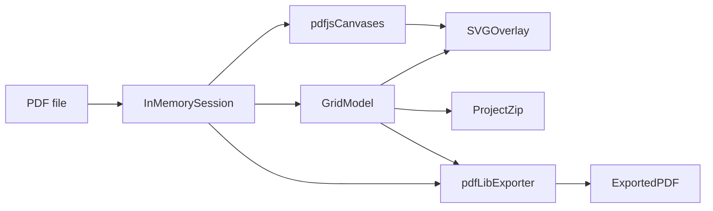

# PDF Table Grid Annotator — Overall Design

**Status:** Living document (v1). Revise in place as decisions change.

**Scope:** A purely frontend application that lets a user upload a PDF, draw editable table grids on each page, save work as a reloadable project, and export a new PDF whose grid lines are part of each page’s **content stream** (vector strokes, not annotation objects).

---

## 1. Goals and non-goals

### Goals

1. Upload a PDF in the browser; no server required.
2. Display all pages using each page’s PDF rotation (`/Rotate`), with an optional **user rotation correction** per page when metadata is wrong (see §4.6).
3. Let the user rotate one or more selected pages by 90° steps (CW/CCW) for viewing and editing; persist corrections in the project file. Rotating a page removes any grids already on it; the user redraws them in the corrected view (§4.6, §6.9).
4. Create one or more table grids per page, each confined to that page.
5. When creating a grid, draw a **table bounding box** on the page; when a text layer is available, **suggest** row and column boundaries from word layout (§6.2), with a **uniform grid fallback** when suggestion is unavailable; the user can add or remove row/column boundaries and edit segments afterward.
6. Move the whole grid; drag individual horizontal or vertical boundaries to vary row/column sizes.
7. For merged cells, remove individual horizontal or vertical **segments** so rules do not cross merged regions; restore segments when needed.
8. Save a **project file** (original PDF + grid JSON) for reload and continued editing.
9. **Export** a PDF with remaining grid segments drawn as stroked paths in the page content stream, and with each page’s **`/Rotate` set to the effective rotation** used during editing (see §9.7).

### Non-goals (v1)

- Tagged PDF tables, accessibility structure, or form fields.
- **OCR** for scanned PDFs without a text layer.
- **Auto-detecting existing vector table lines** in the PDF (only text-layout suggestion in §6.2 is in scope).
- Collaborative editing, accounts, or cloud storage.
- Incremental PDF updates (whole-file rewrite in memory is acceptable).
- Guaranteed PDF/A conformance after export (appending content may break PDF/A).
- **Physical rotation of page content** in the content stream (e.g. scanned pages drawn sideways while `/Rotate` is 0). v1 only adjusts display/export **rotation metadata** and draws grids consistently with the corrected view; it does not rewrite or rasterize existing page content.
- **Password-protected PDFs.** No password prompt, and no open or export path for an encrypted file (§9.5).

---

## 2. Technology choices

### 2.1 Working stack (default)

| Layer           | Choice                    | License    | Role                                                                              |
| --------------- | ------------------------- | ---------- | --------------------------------------------------------------------------------- |
| App shell       | Vite + React + TypeScript | MIT        | UI, tooling, static deploy                                                        |
| PDF display     | pdf.js (`pdfjs-dist`)     | Apache-2.0 | Render pages to canvas; viewport transforms; `getTextContent` for grid suggestion |
| Grid editor     | SVG overlay               | —          | Segments, handles, hit testing                                                    |
| Project archive | fflate (or similar)       | MIT        | Zip `source.pdf` + `project.json`                                                 |
| PDF export      | pdf-lib                   | MIT        | Load bytes, append stroke operators, save                                         |

**Rationale:** pdf.js is the de facto in-browser renderer and exposes viewport mapping for overlay alignment. pdf-lib can append real drawing operators to existing page content streams without rasterizing the page. Both are permissively licensed for a shipped frontend.

**Deployment note:** pdf.js workers do not behave reliably when the app is opened via `file://`. Serve the static build with any local or hosted static server (Vite dev server, GitHub Pages, etc.). The app remains “frontend-only.”

### 2.2 Rejected alternative: MuPDF.wasm

MuPDF can render and edit PDFs in one WASM engine, which reduces coordinate mismatch risk between viewer and exporter and improves fidelity on damaged or unusual files.

**Trade-off:** Larger binary, lower-level API, and **AGPL-3.0** (or commercial license). Shipping to end users under AGPL requires offering corresponding source.

The stack stays **pdf.js + pdf-lib**. v1 does not switch to MuPDF.wasm.

### 2.3 Why not annotations or raster stamps?

- **PDF annotations** (`Line`, `Square`, `Ink` on `/Annots`) are a separate layer. Viewers may hide them; print/flatten workflows often treat them as comments. They are not the same as content-stream drawing.
- **Rasterizing** the page and stamping a bitmap would put pixels in the stream but destroys original vector text and paths.

Export requirement: append path-painting operators (`m`, `l`, `S`, etc.) inside each page’s content stream.

---

## 3. Architecture



### 3.1 Module boundaries

Later implementation plans must respect these seams:

| Module     | Responsibility                                                                                                                                    | Must not                                                            |
| ---------- | ------------------------------------------------------------------------------------------------------------------------------------------------- | ------------------------------------------------------------------- |
| **`core`** | Grid model, edit operations, segment enumeration, undo snapshots, page-box clamping, **`suggestGridFromText`** (§6.2)                             | Import pdf.js, pdf-lib, or React                                    |
| **`pdf`**  | Load document, page boxes, render adapter, export adapter, **view ↔ PDF conversion** (including `effectiveRotate`), text quads → view-space boxes | Own UI state or grid business rules                                 |
| **`ui`**   | File pickers, page list, tools, SVG interaction, wiring to `core` and `pdf`                                                                       | Embed coordinate or remapping logic that belongs in `core` or `pdf` |

All persisted grid geometry lives in **view space** (see §4.1): the page as displayed under `effectiveRotate`. **`core` and `project.json` never store PDF user-space values.** The **`pdf`** module converts on read (text, pointer) and write (export). `core` does not apply rotation; a rotation change deletes grids (§6.9) instead of transforming their coordinates.

---

## 4. Coordinates and page boxes

### 4.1 Canonical space: view space (rotated page, top-left)

The coordinate system for grids, grid clamping, text suggestion, and project JSON is **view space**: the clamp rectangle as displayed under that page’s `effectiveRotate` (§4.6).

| Property | Rule                                                                                |
| -------- | ----------------------------------------------------------------------------------- |
| Origin   | **Top-left** corner of the displayed page (clamp rectangle after `effectiveRotate`) |
| +x       | To the right on the displayed page                                                  |
| +y       | **Down** on the displayed page (same sense as CSS / screen layout)                  |
| Units    | Points (1/72 inch)                                                                  |

`colBoundaries` are **vertical** lines on the displayed page (strictly increasing x). `rowBoundaries` are **horizontal** lines (strictly increasing y down). A 90° or 270° effective rotation swaps which PDF-page axis is vertical on screen; storage follows the screen, so a column separator the user sees stays a column boundary.

**View extents** come from the unrotated clamp box (§4.2):

- `effectiveRotate` 0° or 180°: `viewWidth = pageWidth`, `viewHeight = pageHeight`
- `effectiveRotate` 90° or 270°: `viewWidth = pageHeight`, `viewHeight = pageWidth`

Every boundary lies in `[0, viewWidth]` × `[0, viewHeight]`. The numbers are meaningful only together with that page’s `effectiveRotate`.

**Row order in storage:** `rowBoundaries` are strictly increasing in **y down**. Index `0` is the **top** edge of the grid on the displayed page; higher indices move **down**. UI row “1” can match row span `0` without flipping.

### 4.2 Page clamp rectangle

Grids must stay within the page. For each page:

1. **CropBox** if present and valid.
2. Else **MediaBox**.

The grid’s axis-aligned bounding box must lie within `[0, viewWidth] × [0, viewHeight]` in view space (§4.1). `documentMetadata` holds the PDF clamp box and the unrotated `pageWidth` / `pageHeight` per page. `viewWidth` / `viewHeight` are derived from those extents and `effectiveRotate`.

### 4.3 PDF user space and the unrotated page (library boundary only)

PDF content streams, pdf.js `getTextContent`, and pdf-lib drawing use **PDF default user space**: origin bottom-left of the page box, **y up**.

**Unrotated page space (top-left)** is an intermediate used only inside **`pdf`**. Its origin is the top-left of the clamp rectangle before display rotation, +x right, +y down. Extents are `pageWidth` and `pageHeight` (§4.2). `core` never sees this space.

PDF user space ↔ unrotated page space:

```text
x_pdf = xMin + x_tl
y_pdf = yMax - y_tl
```

Inverse:

```text
x_tl = x_pdf - xMin
y_tl = yMax - y_pdf
```

(`xMin`, `yMax` from that page’s clamp rectangle in PDF user space.)

Unrotated page space ↔ **view space**, with `W = pageWidth` and `H = pageHeight`, for `effectiveRotate`:

```text
0°:    x_v = x_tl          y_v = y_tl
90°:   x_v = H - y_tl      y_v = x_tl
180°:  x_v = W - x_tl      y_v = H - y_tl
270°:  x_v = y_tl          y_v = W - x_tl
```

Inverse (view space → unrotated page space):

```text
0°:    x_tl = x_v          y_tl = y_v
90°:   x_tl = y_v          y_tl = H - x_v
180°:  x_tl = W - x_v      y_tl = H - y_v
270°:  x_tl = W - y_v      y_tl = x_v
```

**Pointer / viewport:** pdf.js maps PDF user space ↔ screen via `PageViewport` with `effectiveRotate`. View space matches that displayed page, so the `pdf` module converts pointer positions to view space before calling `core`. The SVG overlay is driven in view space and lines up with the canvas.

**Text items:** `getTextContent` positions are in PDF user space and may include a text matrix. The `pdf` module transforms each item’s glyph quad into view space and passes axis-aligned bounds `{ xMin, xMax, yMin, yMax }` with `yMin` as the top edge on the displayed page. Suggestion then clusters rows and columns as the user sees them (§6.2).

### 4.4 Display vs export

- **Display:** Render with pdf.js using `effectiveRotate`. Overlay segments are already in view space, so positioning them is the viewport scale and origin (the same adapter as the pointer inverse).
- **Export:** Segment endpoints start in view space from `core`. The export adapter converts **view space → unrotated page space → PDF user space** (§4.3), then emits content-stream operators via pdf-lib. The exported page’s `/Rotate` is set to the same `effectiveRotate` (§9.7), so viewers show the strokes where the user drew them. This is the highest-risk integration point and must be covered by fixtures (§10).

### 4.5 Hit testing tolerance

Pointer proximity to a segment uses a tolerance in CSS pixels (e.g. 6px), converted to points in view space via the current scale so lines remain grabbable when zoomed out.

### 4.6 Page rotation correction

Some PDFs declare an incorrect `/Rotate` (0, 90, 180, or 270) while page content is already laid out in normal user space. The app treats rotation as two parts:

| Term              | Meaning                                                                                               |
| ----------------- | ----------------------------------------------------------------------------------------------------- |
| `pdfRotate`       | Rotation read from the PDF page dictionary (pdf.js / pdf-lib).                                        |
| `rotationOffset`  | User correction for that page, in 90° steps: `0`, `90`, `180`, or `270`. Added on top of `pdfRotate`. |
| `effectiveRotate` | `(pdfRotate + rotationOffset) mod 360`, normalized to `0 \| 90 \| 180 \| 270`.                        |

**Rules:**

- Default `rotationOffset` is `0` for every page after upload.
- **Display and overlay** always use `effectiveRotate` when building the page viewport. Grid geometry is **view space** for that rotation (§4.1).
- **Changing rotation deletes grids, then rotates.** For each selected page whose `effectiveRotate` would change: remove every grid on that page, then update `rotationOffset` (§6.9). Boundary numbers are not transformed. The user redraws grids in the new view. A page with no grids only updates the offset. If the operation would leave `effectiveRotate` unchanged, it does nothing.
- **Undo** of that action is one step and restores both the previous offsets and the removed grids (§6.10).
- **Project file** persists `rotationOffset` per page (§8.2). Stored boundaries are view space at the saved effective rotation. `source.pdf` inside the zip stays unchanged.
- **Export** writes `effectiveRotate` into each exported page’s `/Rotate` via pdf-lib (§9.7). Grid strokes are converted view space → PDF and appended with the same effective rotation as display. This fixes wrong rotation metadata for downstream viewers when content was drawn for the uncorrected box.

**UI:** Page sidebar or toolbar actions: select one or more pages, **Rotate 90° CW**, **Rotate 90° CCW**, **Reset rotation** (set `rotationOffset` so `effectiveRotate === pdfRotate`, i.e. offset back to `0`). Show a small indicator when `rotationOffset !== 0`.

**Scope limit:** This corrects **metadata and viewing/export alignment** for the common “wrong `/Rotate` flag” case. It does not rotate existing vector/text content inside the stream when the artwork itself is sideways.

---

## 5. Data model

### 5.1 Session (in memory)

- `sourcePdfBytes: ArrayBuffer` — immutable original upload (also embedded in project zip).
- `documentMetadata` — page count, per-page PDF clamp box, unrotated `pageWidth` / `pageHeight`, `pdfRotate` (from pdf.js / pdf-lib loaders). `viewWidth` / `viewHeight` are derived (§4.1).
- `pageRotationOffsets: number[]` — length = page count; each entry is `0 | 90 | 180 | 270` (default `0`). Effective rotation is derived (§4.6).
- `grids: Grid[]` — all grids across all pages. Boundaries are view space for the page’s current `effectiveRotate`.
- `style: GridStyle` — one line style for every grid (§5.3). The editor and export both use it.
- `history` — undo stack (cap ~100). Each entry snapshots `grids`, `pageRotationOffsets`, and `style` together, so undoing a rotation restores the previous offset and any grids that rotation removed.

### 5.2 Grid

```ts
type SegmentRef = {
  axis: "vertical" | "horizontal";
  rowIndex: number; // index into rowBoundaries
  columnIndex: number; // index into colBoundaries
};

type GridStyle = {
  strokeColor: string; // e.g. "#000000"
  strokeWidth: number; // points, default 0.75
};

type Grid = {
  id: string; // stable UUID for selection and project JSON
  pageIndex: number; // 0-based
  colBoundaries: number[]; // length = columns + 1, strictly increasing x (view space)
  rowBoundaries: number[]; // length = rows + 1, strictly increasing y down (view space)
  removedSegments: SegmentRef[];
};
```

**Spans:** Column span `c` lies between `colBoundaries[c]` and `colBoundaries[c+1]`. Row span `r` lies between `rowBoundaries[r]` and `rowBoundaries[r+1]`.

**Row labeling in UI:** Row span `0` is the **topmost** row on the displayed page (`rowBoundaries[0]` is the top edge). Label “row 1” as span `0` if desired; storage order is top → bottom (increasing y down).

**Segments (exportable pieces):** Each `SegmentRef` is the unit edge whose top-left corner is `(colBoundaries[columnIndex], rowBoundaries[rowIndex])`. `columnIndex` always indexes `colBoundaries`. `rowIndex` always indexes `rowBoundaries`. `axis` selects the direction:

- **Vertical:** from `(colBoundaries[columnIndex], rowBoundaries[rowIndex])` to `(colBoundaries[columnIndex], rowBoundaries[rowIndex + 1])`. `columnIndex` is the vertical line. `rowIndex` is the start of the row span.
- **Horizontal:** from `(colBoundaries[columnIndex], rowBoundaries[rowIndex])` to `(colBoundaries[columnIndex + 1], rowBoundaries[rowIndex])`. `rowIndex` is the horizontal line. `columnIndex` is the start of the column span.

**Valid ranges** depend on that grid’s boundary arrays. The type does not encode them; edit operations and project load reject or drop a ref outside these bounds:

- **Vertical:** `columnIndex` ∈ `[0, colBoundaries.length - 1]` (the line, including both outer borders), `rowIndex` ∈ `[0, rowBoundaries.length - 2]` (start of a row span).
- **Horizontal:** `rowIndex` ∈ `[0, rowBoundaries.length - 1]` (the line, including both outer borders), `columnIndex` ∈ `[0, colBoundaries.length - 2]` (start of a column span).

A segment is **drawn** (editor + export) iff it is not listed in `removedSegments`.

**Editor-only chrome:** Bounding box and resize/move handles for selection are not segments and are never exported.

### 5.3 Constants

- `MIN_BOUNDARY_GAP_PT = 4` — minimum distance between adjacent boundaries on the same axis.
- Default style: black (`#000000`), width `0.75` pt, butt caps, miter joins (export sets explicit graphics state).

### 5.4 Multiple grids

- Any number of grids per page; grids may overlap visually.
- When two grids share an edge, the editor and export draw both strokes. Boundaries are not snapped together.
- A single grid cannot span multiple pages.

---

## 6. Edit operations

All operations validate view-space page bounds and minimum gap. Failed operations clamp or reject according to rules below.

### 6.1 Create grid

1. User drags a **table bounding box** on **one** page (create-grid tool active on that page).
2. The drag rectangle is clamped to the view-space page bounds `[0, viewWidth] × [0, viewHeight]` (§4.1).
3. On release, if the rectangle is too small to satisfy `MIN_BOUNDARY_GAP_PT` for at least one row and one column, discard creation.
4. **Primary path (text layer present):** Run **§6.2 Suggest grid from text** using words clipped to the bbox. If suggestion succeeds, create a `Grid` with the returned `colBoundaries` and `rowBoundaries`.
5. **Fallback path:** If the page has no extractable text, suggestion returns failure because no clipped items remain (§6.2 step 2), or the user disables “Suggest from text,” use a **uniform grid:** user-supplied `initialRows ≥ 1` and `initialColumns ≥ 1` (toolbar defaults, e.g. 3×3) divide the bbox into equal spans.
6. `removedSegments` starts empty.

The bbox used at create time becomes the grid’s outer boundary (first/last entries in `colBoundaries` / `rowBoundaries`). The user refines with §6.4–§6.7 afterward.

### 6.2 Suggest grid from text

**Purpose:** Produce an initial grid that matches visible table rows and column gutters so the user only adjusts edge cases (merged cells, missing lines, OCR-free scans).

**Input (from `pdf` module):** Text items converted to **axis-aligned boxes in view space** (§4.3). Each item has `{ xMin, xMax, yMin, yMax }` with `yMin`/`yMax` in y-down order (`yMin` = top edge of the box on the displayed page, `yMax` = bottom). Rows and columns therefore match the upright view, including when `effectiveRotate` is 90° or 270°.

**Input (from UI):** Table bbox `{ xMin, xMax, yMin, yMax }` in view space from the user drag.

**Algorithm (`core.suggestGridFromText`):**

1. **Clip:** Keep items whose boxes intersect the table bbox (ignore outside text).
2. **If zero items remain:** Return failure → create flow uses uniform fallback (§6.1 step 5).
3. **Row grouping:** Cluster items that belong to the same logical row:
   - Use a vertical anchor per item (default: vertical center y; implementation may use baseline if stable).
   - Sort by anchor y (**top → bottom**, increasing y down).
   - Merge items into the same cluster when their anchors differ by less than a tolerance derived from median item height (e.g. max(2 pt, 0.35 × median height)).
   - Each cluster is one **row**.
4. **Row boundaries (horizontal):**
   - Outermost: `rowBoundaries[0] = bbox.yMin` (top), `rowBoundaries[n] = bbox.yMax` (bottom).
   - For each gap between adjacent row clusters (earlier cluster = **upper** on the displayed page = smaller y, later cluster = **lower** = larger y), place an internal boundary at the **vertical midpoint** between the bottom of the upper cluster’s union box (`yMax`) and the top of the lower cluster’s union box (`yMin`).
   - Enforce `MIN_BOUNDARY_GAP_PT` by merging rows. A too-small gap is a local defect; the rest of the suggestion stays.
     - While any consecutive pair is closer than `MIN_BOUNDARY_GAP_PT`, take the closest such pair and drop its internal boundary. If both boundaries are internal, drop the earlier one (smaller y). Merge the two clusters that boundary separated. A pair that includes `bbox.yMin` or `bbox.yMax` drops the edge-adjacent internal boundary, so the outer span absorbs the short row.
     - After each merge, recompute every internal boundary from the new clusters (same midpoint rule). Outer boundaries stay at `bbox.yMin` and `bbox.yMax`.
     - Repeat until every consecutive pair is at least `MIN_BOUNDARY_GAP_PT` apart. Each pass removes one internal boundary, so the loop ends. One full-height row is a successful suggestion. The user can split that span afterward (§6.5).
5. **Column occupancy (horizontal intervals without words):**
   - Over the full table bbox height (from `bbox.yMin` to `bbox.yMax`), build x-coverage: mark x intervals covered by any clipped item’s `[xMin, xMax]`.
   - Uncovered x intervals inside `[bbox.xMin, bbox.xMax]` are **gutters**.
   - Ignore gutters narrower than `MIN_BOUNDARY_GAP_PT` (treat as noise / tight kerning).
6. **Column boundaries (vertical):**
   - Outermost: `colBoundaries[0] = bbox.xMin`, `colBoundaries[m] = bbox.xMax`.
   - For each qualifying gutter, place an internal vertical boundary at the **horizontal center of the gutter** (product decision: **gap centers**, not gap edges).
   - Enforce `MIN_BOUNDARY_GAP_PT` by dropping column boundaries, same policy as rows. Gutters narrower than the minimum are already ignored above; a remaining violation is a gutter center closer than the minimum to `bbox.xMin`, `bbox.xMax`, or another boundary.
     - While any consecutive pair is closer than `MIN_BOUNDARY_GAP_PT`, take the closest such pair and drop its internal boundary. If both are internal, drop the earlier one (smaller x). Other gutter centers stay where they are.
     - Repeat until every consecutive pair is at least `MIN_BOUNDARY_GAP_PT` apart. One full-width column is a successful suggestion. The user can split that span afterward (§6.5).
7. **Output:** `{ colBoundaries, rowBoundaries }` strictly increasing, length ≥ 2 each. No `removedSegments` (user adds those for merged cells).

**After suggestion:** Same grid model as manual create; all edit operations apply.

**Limitations (documented, not blocking v1):**

- Multi-line cells may split into multiple suggested rows.
- Rows or columns closer than `MIN_BOUNDARY_GAP_PT` are merged into one span; the user splits that span afterward (§6.5).
- Ragged or misaligned columns may produce extra gutters; user removes or merges boundaries.
- Scanned PDFs without a text layer always use uniform fallback until OCR is added (non-goal).

**Testing:** Unit tests in `core` with synthetic text boxes (no pdf.js); integration tests with fixture PDFs that have known table text.

### 6.3 Move grid (translate)

Drag from grid interior (not on a boundary handle):

- Add `(dx, dy)` to every entry in `colBoundaries` and `rowBoundaries`.
- Clamp translation so the grid’s bounding box stays inside `[0, viewWidth] × [0, viewHeight]`.
- Removed segments move with their boundaries; removals are not auto-restored.

### 6.4 Drag single boundary

Drag near an internal or edge boundary:

- Move only that boundary coordinate on its axis.
- Clamp between neighbors: `prev + MIN_BOUNDARY_GAP_PT` and `next - MIN_BOUNDARY_GAP_PT`.
- Edge boundaries also clamp to `[0, viewWidth]` or `[0, viewHeight]` on that axis.
- Segments on that boundary remain removed or present; dragging does not recreate removed segments.

### 6.5 Add row or column (split span)

User selects a row span or column span (or uses context action on selection), then **split at midpoint** of that span.

**Split column span `s` (insert new vertical boundary):**

- Insert new x at midpoint between `colBoundaries[s]` and `colBoundaries[s+1]`. The new boundary’s index is `s+1`; column boundaries that were at an index greater than `s` move to index + 1.
- Do not append to `removedSegments`. Existing entries still refer to the boundaries and spans from before the split.
- Increment `columnIndex` by +1 on every existing entry where `columnIndex > s`, so those entries keep that reference after the insertion. An entry with `columnIndex === s` stays at `s` and now covers only the left half of the split span.
- The new boundary (`columnIndex === s+1`) has no `removedSegments` entries. Its vertical segments are drawn, and so are the horizontal segments on the new span.

**Split row span `s`:** Symmetric on `rowIndex`. Do not append to `removedSegments`. Increment `rowIndex` where `rowIndex > s`. The new horizontal boundary is drawn.

### 6.6 Remove row or column

At least one row and one column must remain.

**Remove column span `s` (merge columns s and s+1):**

- Delete boundary at index `s+1` (remove `colBoundaries[s+1]`).
- Shift all x boundaries with index > s+1 left by width of span `s` (grid narrows; left edge fixed).
- Drop vertical removed-segments on the deleted line (`columnIndex === s+1`).
- Drop horizontal removed-segments on the removed span (`columnIndex === s`).
- Decrement `columnIndex` by 1 on every remaining removed segment where `columnIndex > s`.

**Remove row span `s`:** Symmetric on `rowIndex`. Drop horizontal removed-segments on the deleted line (`rowIndex === s+1`) and vertical removed-segments on the removed span (`rowIndex === s`), then decrement `rowIndex` by 1 wherever `rowIndex > s`. The **top** edge of the grid stays fixed in view space; lower boundaries move up.

### 6.7 Merged cells (segment remove / restore)

- **Remove segment:** Add `SegmentRef` to `removedSegments` (toggle off one horizontal or vertical piece, including outer border segments).
- **Restore segment:** Remove matching ref from `removedSegments`.

There is no separate “merge metadata” structure. Merged appearance is entirely “which segments are absent.” Export draws only non-removed segments.

### 6.8 Delete grid

Remove grid from `grids` by `id`.

### 6.9 Page rotation (selected pages)

For each selected page, compute the `rotationOffset` the action would store and the resulting `effectiveRotate`.

- **Rotate 90° CW / CCW:** Add `+90` or `+270` to `pageRotationOffsets[i]` (mod 360, store as `0 | 90 | 180 | 270`).
- **Reset rotation:** Set `pageRotationOffsets[i] = 0`.

If that page’s `effectiveRotate` would be unchanged, skip it. Otherwise, **remove every grid on that page first**, then store the new offset. Do not transform `colBoundaries`, `rowBoundaries`, or `removedSegments`. The user creates new grids in the updated view space.

Does not modify `sourcePdfBytes`. Triggers re-render of affected pages only. One undo step covers the whole batch (§6.10).

### 6.10 Undo

- Snapshot: deep copy of `grids`, `pageRotationOffsets`, and `style` (or structural sharing if immutable updates).
- One snapshot per completed gesture: pointer-up on drag, discrete actions for add/remove/split/delete segment/delete grid, a change to the global line style, and each page-rotation batch (grid deletion and offset change together).
- Cap stack depth (~100). v1 is undo only; there is no redo stack.

---

## 7. User interface (high level)

### 7.1 Layout

- **Toolbar:** Open PDF, save project, load project, export PDF, undo; tool mode (select / create grid / remove segment); **create grid:** “Suggest from text” toggle (default on when page has text), row/column inputs for **uniform fallback** only; global line style (color and width, §5.1); **page rotation** (CW / CCW / reset) applying to the current page selection. Rotation removes grids on each page whose effective rotation changes (§6.9).
- **Main area:** Vertically stacked pages (or virtualized list for large documents). Each page: canvas (pdf.js) + SVG overlay aligned to the same viewport transform (`effectiveRotate`).
- **Sidebar (optional):** Page thumbnails with multi-select, rotation indicator when corrected, list of grids on current page, warnings (e.g. grids on missing pages after reload).

### 7.2 Tools

| Tool               | Behavior                                                                                 |
| ------------------ | ---------------------------------------------------------------------------------------- |
| Select             | Click grid to select; drag interior to move; drag boundary to resize spans               |
| Create grid        | Drag table bbox; suggest boundaries from text (§6.2) or uniform rows/columns if fallback |
| Remove segment     | Click segment to toggle removal (shift-click or second tool mode to restore)             |
| Add/remove row/col | Context menu or panel actions on selected grid                                           |

### 7.3 Feedback

- Hover highlight on segments and boundaries.
- Selected grid: bounding box + handles (not exported).
- Visual distinction for removed segments (e.g. dashed or hidden in “preview export” mode — product choice in UI plan).

---

## 8. Project file format

### 8.1 Container

Zip archive with extension `.zip`:

| Entry          | Content                       |
| -------------- | ----------------------------- |
| `source.pdf`   | Original PDF bytes, unchanged |
| `project.json` | UTF-8 JSON (schema below)     |

### 8.2 `project.json` (version 1)

```json
{
  "version": 1,
  "sourceSha256": "<hex SHA-256 of source.pdf>",
  "pageRotationOffsets": [0, 90, 0],
  "style": { "strokeColor": "#000000", "strokeWidth": 0.75 },
  "grids": [/* Grid[] serialized */]
}
```

- `pageRotationOffsets` is optional on load for backward compatibility; missing array implies all zeros. Length should match page count; if shorter, pad with `0`; if longer, ignore extras and warn.
- `style` is the global line style (§5.1). A missing object uses the §5.3 default.
- Grid boundary numbers in `grids` are **view space** for the corresponding `pageIndex` at that page’s effective rotation (`pdfRotate` from `source.pdf` plus `pageRotationOffsets`). Reload assumes the source PDF clamp boxes match; if not, warn and clamp or skip affected grids (implementation detail in plan 6).

### 8.3 Load behavior

1. Parse zip; read `source.pdf` and `project.json`.
2. Verify `sourceSha256` matches loaded PDF bytes.
3. Load PDF in viewer; compare page count and page box sizes to expectations if stored (optional extension: store `pageCount` in JSON for clearer errors).
4. Grids with `pageIndex >= pageCount`: keep in JSON, omit from export, show warning in UI.

---

## 9. PDF export

### 9.1 Pipeline

1. Load `sourcePdfBytes` with pdf-lib (not the project zip copy unless user exports from current session — session always holds canonical bytes).
2. For each page index, compute `effectiveRotate` (§4.6) and **set the page rotation** in the output document to that value (§9.7).
3. Collect all non-removed segments from all grids on that page.
4. Convert each segment from view space to PDF user space (§4.3) and append drawing commands. The page’s `/Rotate` is already `effectiveRotate`, matching the viewer.

### 9.2 Graphics state

Wrap appended content in `q` … `Q`. Set explicitly:

- Stroke color (RGB from the global style)
- Line width (from the global style)
- Line cap (butt) and join (miter)

Do not rely on inherited state from existing page content (blend modes, extended graphics state).

### 9.3 Segment drawing

Each remaining segment is a separate stroked line (a removed middle piece breaks what was one logical rule into two export paths).

Default: moveto–lineto–stroke per segment. Optimization (merge colinear contiguous segments on same boundary) is optional later; correctness first.

### 9.4 Output

- Download as new file (e.g. `annotated.pdf`).
- Does not mutate project `source.pdf` or in-memory original bytes.

### 9.5 Encrypted PDFs

Out of scope for now (§1 non-goals). The app does not prompt for a password and does not open or export an encrypted PDF.

### 9.6 Verification

Automated tests should render exported PDF (pdf.js) and sample pixels along expected segment locations for fixture documents (rotation, crop box). Manual spot-check in Acrobat/Foxit recommended for first release.

### 9.7 Page `/Rotate` on export

For each page in the exported PDF:

1. Compute `effectiveRotate` from the session’s `pdfRotate` and `pageRotationOffsets[pageIndex]` (§4.6).
2. Set the exported page’s rotation to `effectiveRotate` (pdf-lib page rotation API). This updates the page dictionary `/Rotate` entry in the saved file.
3. Convert grid strokes from view space to PDF user space (§4.3) and append them, so lines match what the user saw in the editor.

The in-memory **source** bytes and the `source.pdf` entry in a project zip are never modified; only the downloaded export reflects corrected rotation.

**Expectation:** When the source problem is incorrect `/Rotate` metadata, export produces a file that displays upright in standard viewers together with the new grid lines. When content itself is drawn sideways, export still only adjusts `/Rotate` and appended strokes — same limitation as §4.6.

---

## 10. Testing strategy

| Area            | Approach                                                                                                                                                                                                           |
| --------------- | ------------------------------------------------------------------------------------------------------------------------------------------------------------------------------------------------------------------ |
| `core` edit ops | Pure unit tests: boundaries, remapping of `removedSegments`, min gap, page clamp; **`suggestGridFromText`** with synthetic word boxes                                                                              |
| Coordinates     | View ↔ unrotated page ↔ PDF round-trip tests, including 90° and 270° axis swap; fixture PDFs: portrait, landscape, Rotate 90/180/270, CropBox ≠ MediaBox; non-zero `rotationOffset` with matching export `/Rotate` |
| Export          | Byte-level smoke (PDF loads) + rendered pixel probes on known segment positions; assert exported `/Rotate` equals `effectiveRotate`                                                                                |
| Page rotation   | Unit: a rotation that changes `effectiveRotate` removes that page’s grids and leaves other pages alone; unchanged effective rotation is a no-op. Manual: wrong-Rotate fixture + offset + export opens upright      |
| UI              | Component tests optional; critical path E2E optional later                                                                                                                                                         |

**Gate:** Coordinate fixtures (implementation plan 2) and core grid tests (plan 3) must pass before building the SVG overlay (plan 4).

---

## 11. Performance and limits

- Entire PDF held in memory; very large files limited by browser tab memory.
- Prefer cancelable pdf.js render tasks when zooming or scrolling.
- Virtualize page list for documents with many pages (implementation plan 8).
- Export is O(pages × segments); typical annotation workloads are small.

---

## 12. Security and privacy

- No upload to server; processing stays in the client.
- Project files contain the full PDF; users handle sharing/storage.
- No eval of PDF JavaScript beyond what the PDF libraries perform; treat malicious PDFs like any client-side parser risk (keep dependencies updated).

---

## 13. Implementation plan seams

Each item below should become a **separate detailed plan** that can land independently while preserving §3 module boundaries and §4 coordinate rules.

| #   | Plan                          | Delivers                                                                                                                               |
| --- | ----------------------------- | -------------------------------------------------------------------------------------------------------------------------------------- |
| 1   | App shell and viewer          | Vite/React/TS, open PDF, pdf.js multi-page view, zoom/pan                                                                              |
| 2   | Coordinates                   | Page clamp rect, **view space**, view ↔ PDF adapter (with `effectiveRotate`), viewport/pointer, text quads → view boxes, fixture tests |
| 3   | Core grid operations          | Model + all §6 edits (except text suggestion), unit tests, no UI                                                                       |
| 3b  | Text-assisted grid suggestion | `pdf` text adapter + `core.suggestGridFromText` (§6.2), unit/integration tests                                                         |
| 4   | SVG overlay                   | Create (bbox + suggestion hook), move, drag boundaries, add/remove rows/cols, segment toggle                                           |
| 5   | Selection and undo            | Selection model, history stack, keyboard nudge (optional)                                                                              |
| 6   | Project zip                   | Save/load §8 format, hash check, missing-page warnings                                                                                 |
| 7   | Content-stream export         | pdf-lib adapter, set `/Rotate` on export, download, visual regression on fixtures                                                      |
| 8   | Scale and polish              | Page virtualization, render cancellation, page multi-select rotation                                                                   |

**Order constraint:** Plans **2** and **3** before **4**. Plan **3b** before or with **4** (create-grid UX depends on it).

---

## Document history

| Version | Date       | Notes                                                                                                                                                                                                              |
| ------- | ---------- | ------------------------------------------------------------------------------------------------------------------------------------------------------------------------------------------------------------------ |
| 1       | 2026-09-26 | Initial overall design; working stack pdf.js + pdf-lib; project zip + content-stream export                                                                                                                        |
| 1.1     | 2026-09-26 | Per-page rotation correction (§4.6); export sets `/Rotate` to effective rotation (§9.7)                                                                                                                            |
| 1.2     | 2026-10-07 | Text-assisted grid suggestion (§6.2); column lines at gutter **centers**; OCR/vector line detect remain non-goals                                                                                                  |
| 1.3     | 2026-10-07 | **Canonical page space (top-left, y down)**; TL ↔ PDF conversion only in `pdf` module (§4)                                                                                                                         |
| 1.4     | 2026-10-08 | **Canonical view space** for grids and suggestion (§4.1, §6.2); rotation deletes that page’s grids instead of transforming them (§4.6, §6.9)                                                                       |
| 1.5     | 2026-10-08 | `SegmentRef` uses `rowIndex` and `columnIndex` into `rowBoundaries` and `colBoundaries` (§5.2); split/remove remap those indices (§6.5, §6.6). A split does not add `removedSegments` entries for the new boundary |
| 1.6     | 2026-10-08 | Password-protected PDFs are out of scope (§1, §9.5); password UI removed from plan 8                                                                                                                               |
| 1.7     | 2026-10-08 | Project archive extension is `.zip` (§8.1)                                                                                                                                                                         |
| 1.8     | 2026-10-08 | v1 is undo only; no redo stack (§6.10)                                                                                                                                                                             |
| 1.9     | 2026-10-08 | One global line style for every grid (§5.1, §8.2); `Grid` no longer stores `style`                                                                                                                                 |
| 1.10    | 2026-10-08 | Overlapping grids draw both strokes; shared edges are not snapped (§5.4)                                                                                                                                           |
| 1.11    | 2026-10-08 | Stack stays pdf.js + pdf-lib; no switch to MuPDF.wasm (§2.2)                                                                                                                                                       |
